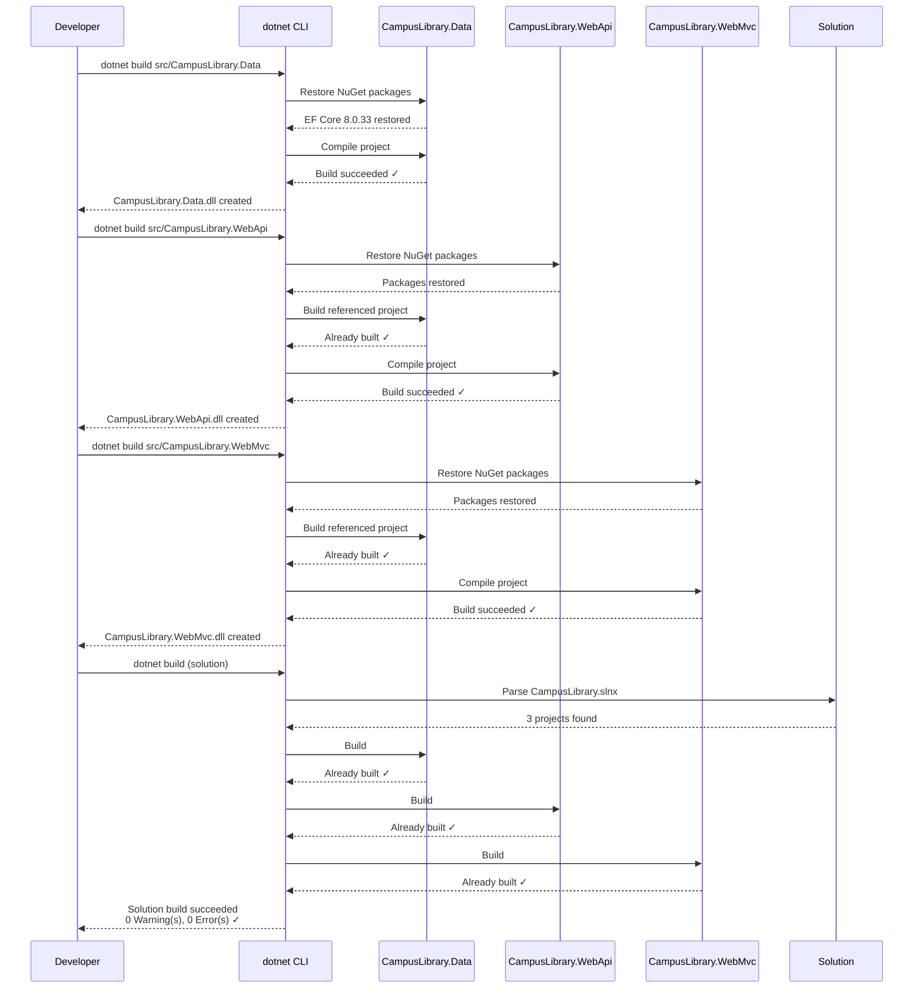
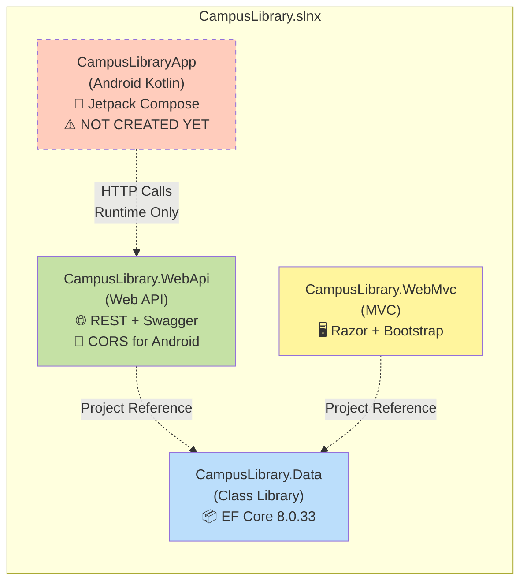
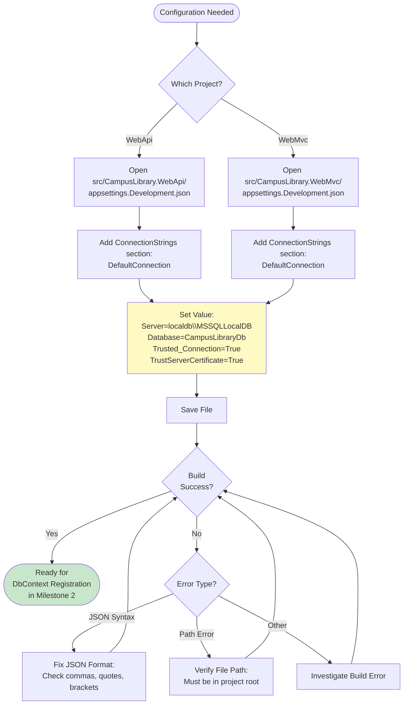
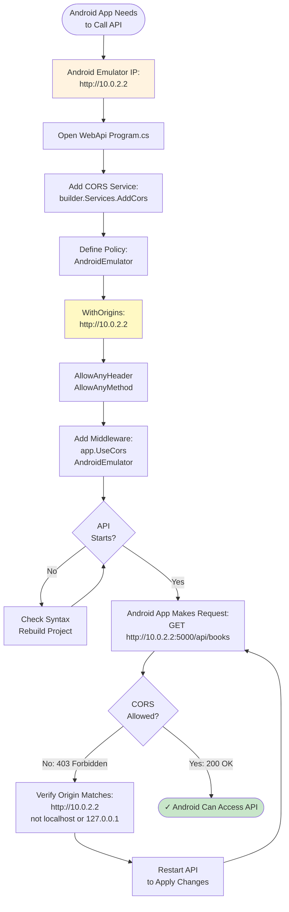
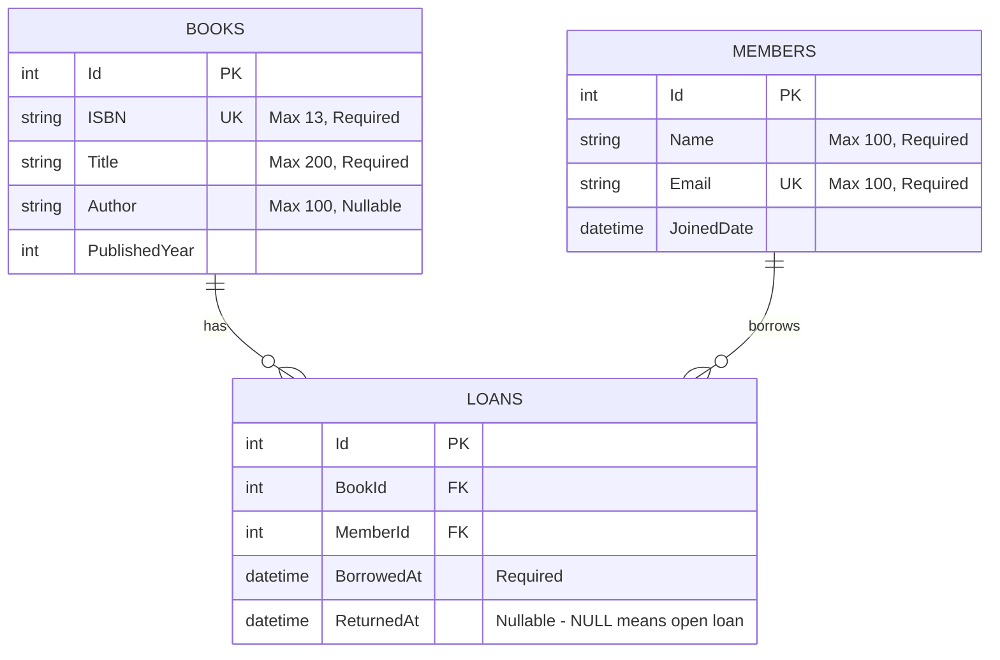

# Flowcharts: Project Structure Setup

## 1. Solution Setup Flow

```mermaid
flowchart TD
    Start([Start: Milestone 1]) --> CreateSln[Create CampusLibrary.slnx]
    CreateSln --> CreateData[Create Data Class Library]
    CreateData --> AddEFPackages[Add EF Core Packages<br/>SqlServer & Design 8.0.33]
    AddEFPackages --> AddDataToSln[Add Data to Solution]
    AddDataToSln --> BuildData{Build Data<br/>Success?}
    BuildData -->|No| FixDataErrors[Fix Build Errors]
    FixDataErrors --> BuildData
    BuildData -->|Yes| CreateWebApi[Create WebApi Project]
    
    CreateWebApi --> AddApiPackages[Add EF Core to WebApi]
    AddApiPackages --> RefApiData[Add Project Reference<br/>WebApi → Data]
    RefApiData --> ConfigCORS[Configure CORS<br/>for Android Emulator]
    ConfigCORS --> ConfigConnStr1[Add Connection String<br/>to appsettings.Development.json]
    ConfigConnStr1 --> BuildApi{Build WebApi<br/>Success?}
    BuildApi -->|No| FixApiErrors[Fix Build Errors]
    FixApiErrors --> BuildApi
    BuildApi -->|Yes| AddApiToSln[Add WebApi to Solution]
    
    AddApiToSln --> CreateWebMvc[Create WebMvc Project]
    CreateWebMvc --> AddMvcPackages[Add EF Core to WebMvc]
    AddMvcPackages --> RefMvcData[Add Project Reference<br/>WebMvc → Data]
    RefMvcData --> ConfigConnStr2[Add Connection String<br/>to appsettings.Development.json]
    ConfigConnStr2 --> BuildMvc{Build WebMvc<br/>Success?}
    BuildMvc -->|No| FixMvcErrors[Fix Build Errors]
    FixMvcErrors --> BuildMvc
    BuildMvc -->|Yes| AddMvcToSln[Add WebMvc to Solution]
    
    AddMvcToSln --> BuildSolution{Build All<br/>dotnet build<br/>Success?}
    BuildSolution -->|No| FixSlnErrors[Fix Solution Errors]
    FixSlnErrors --> BuildSolution
    BuildSolution -->|Yes| AndroidCheck{Android SDK<br/>Available?}
    
    AndroidCheck -->|Yes| CreateAndroid[Create Android Project]
    CreateAndroid --> ConfigManifest[Configure Manifest<br/>INTERNET permission<br/>cleartext traffic]
    ConfigManifest --> BuildAndroid{./gradlew<br/>assembleDebug<br/>Success?}
    BuildAndroid -->|No| FixAndroidErrors[Fix Android Errors]
    FixAndroidErrors --> BuildAndroid
    BuildAndroid -->|Yes| Complete([Phase 1 Complete:<br/>All 4 Projects Created])
    
    AndroidCheck -->|No| DeferAndroid[Defer Android<br/>Document in TODO]
    DeferAndroid --> PartialComplete([Phase 1 Partial:<br/>3/4 Projects Created])
    
    style CreateSln fill:#e1f5ff
    style CreateData fill:#e1f5ff
    style CreateWebApi fill:#e1f5ff
    style CreateWebMvc fill:#e1f5ff
    style CreateAndroid fill:#fff3e0
    style Complete fill:#c8e6c9
    style PartialComplete fill:#fff9c4
```

## 2. Build Verification Sequence

## 3. Project Dependency Graph

## 4. Connection String Configuration Flow

## 5. CORS Configuration for Android

## 6. Entity Relationship Diagram (Milestone 2 Preview)

**Note:** This ERD shows the planned schema for Milestone 2. In Phase 1 (current milestone), no entities or database tables exist yet - only the project structure and connection strings are configured.
