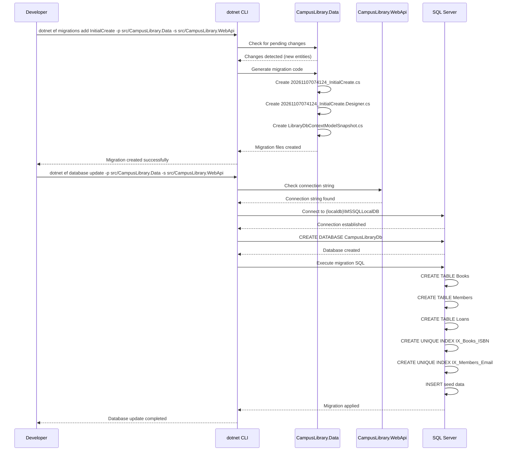
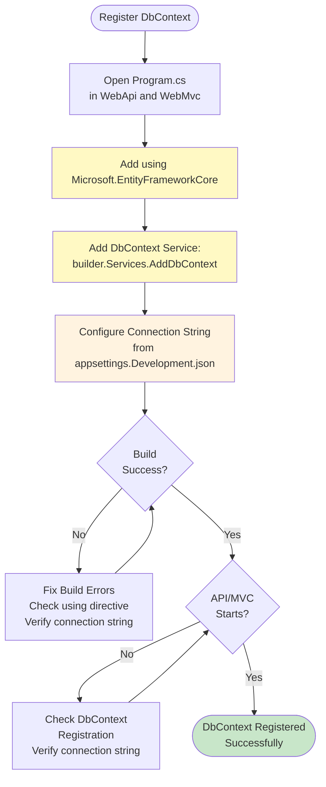
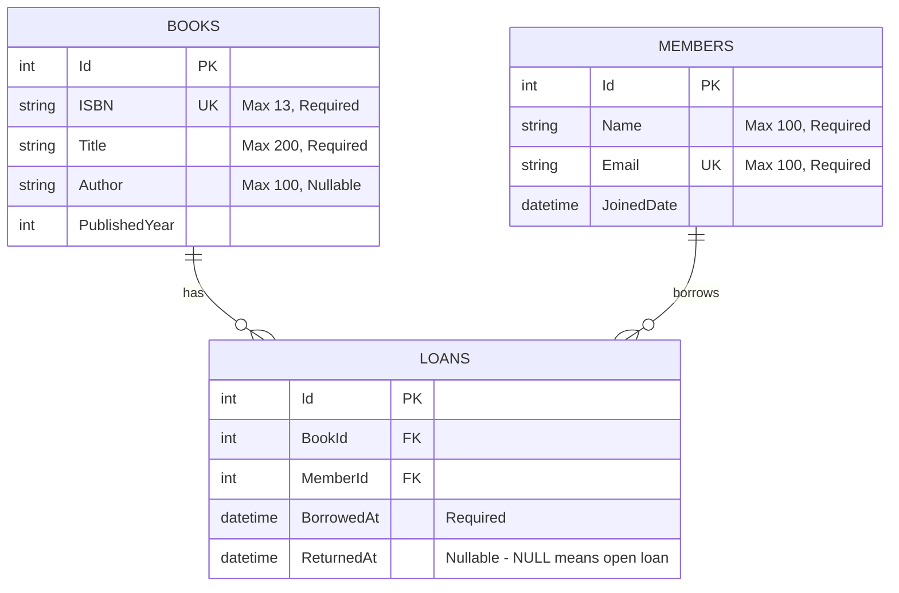
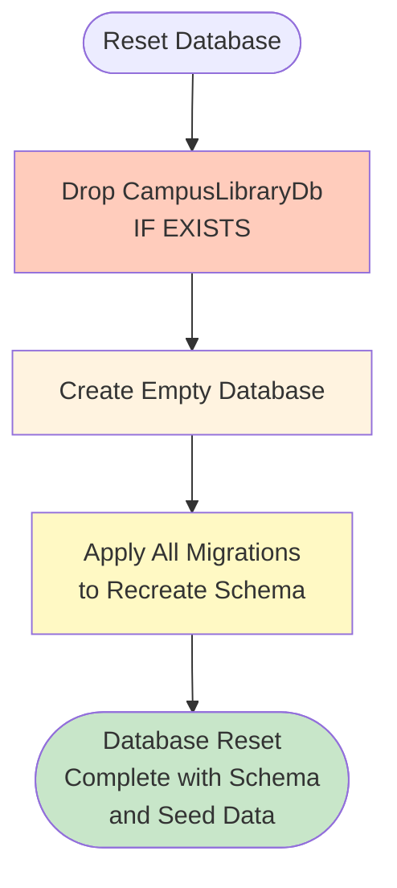
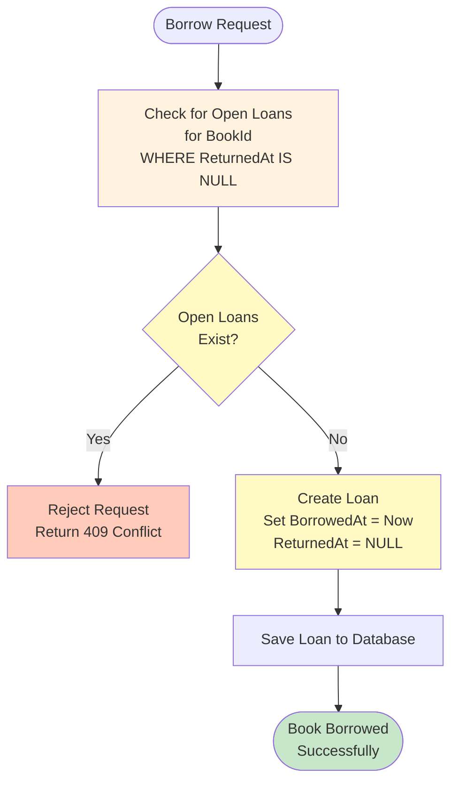

# Flowcharts: EF Core Entities, DbContext, and Database

## 1. Entity Creation Flow

```mermaid
flowchart TD
    Start([Start: Milestone 2]) --> CreateEntities[Create Entity Classes
Book.cs, Member.cs, Loan.cs]
    CreateEntities --> AddDataAnnotations[Add Data Annotations
[Required], [MaxLength], etc.]
    AddDataAnnotations --> AddNavProps[Add Navigation Properties
ICollection<Loan>]
    AddNavProps --> CreateDbContext[Create LibraryDbContext
with DbSet<T> properties]
    CreateDbContext --> ConfigIndexes[Configure Unique Indexes
for ISBN and Email]
    ConfigIndexes --> AddSeedData[Add Seed Data
5 books, 3 members]
    AddSeedData --> BuildData{Build Data Project
Success?}
    
    BuildData -->|No| FixDataErrors[Fix Build Errors]
    FixDataErrors --> BuildData
    
    BuildData -->|Yes| RegisterDbContext[Register DbContext in
WebApi & WebMvc
Program.cs]
    RegisterDbContext --> AddUsing[Add using Microsoft.EntityFrameworkCore]
    AddUsing --> AddDesignPackage[Add EF Core Design
to WebApi project]
    AddDesignPackage --> CreateMigration[Create Migration
InitialCreate]
    CreateMigration --> ApplyMigration[Apply Migration
to Create Database]
    ApplyMigration --> VerifySchema{Database Schema
Created Correctly?}
    
    VerifySchema -->|No| FixSchema[Fix Schema Issues]
    FixSchema --> ApplyMigration
    
    VerifySchema -->|Yes| Complete([Milestone 2 Complete:<br/>Database Created with Schema<br/>and Seed Data])
    
    style CreateEntities fill:#e1f5ff
    style CreateDbContext fill:#e1f5ff
    style ConfigIndexes fill:#fff3e0
    style AddSeedData fill:#fff3e0
    style RegisterDbContext fill:#fff9c4
    style CreateMigration fill:#fff9c4
    style ApplyMigration fill:#fff9c4
    style Complete fill:#c8e6c9
```

## 2. Migration Creation Sequence



## 3. Database Schema Flow

```mermaid
flowchart TD
    Start([Database Schema]) --> Books[Books Table
int Id (PK)
string ISBN (UK)
string Title
string Author
int PublishedYear] --> Members[Members Table
int Id (PK)
string Name
string Email (UK)
datetime JoinedDate]

    Books --> Loans[Loans Table
int Id (PK)
int BookId (FK)
int MemberId (FK)
datetime BorrowedAt
datetime ReturnedAt] --> Members
    
    Loans -.->|FK Constraint| Books
    Loans -.->|FK Constraint| Members
    
    style Books fill:#bbdefb
    style Members fill:#fff59d
    style Loans fill:#c5e1a5
```

## 4. Loan Business Rule Flow

```mermaid
flowchart TD
    Start([Borrow Book Request]) --> CheckAvailability{Book Available?
(No open loans)} -->|Yes| CreateLoan[Create Loan
Set BorrowedAt = Now
ReturnedAt = NULL]
    
    CheckAvailability -->|No| Reject[Reject Request
Return 409 Conflict]
    
    CreateLoan --> SaveLoan[Save Loan to Database]
    SaveLoan --> Success([Book Borrowed Successfully])
    
    ReturnBook([Return Book Request]) --> UpdateLoan[Update Loan
Set ReturnedAt = Now]
    UpdateLoan --> SaveReturn[Save Updated Loan]
    SaveReturn --> Returned([Book Returned Successfully])
    
    style CheckAvailability fill:#fff3e0
    style CreateLoan fill:#fff9c4
    style Success fill:#c8e6c9
    style Returned fill:#c8e6c9
```

## 5. DbContext Registration Flow



## 6. Seed Data Insertion Flow

```mermaid
flowchart TD
    Start([Seed Data Insertion]) --> BooksData[5 Books
Effective Java, Clean Code,
Design Patterns,
The Pragmatic Programmer,
The Clean Coder] --> MembersData[3 Members
John Doe, Jane Smith,
Bob Johnson]
    
    BooksData --> InsertBooks[INSERT INTO Books
VALUES (1, '9780134685991', 'Effective Java', 'Joshua Bloch', 2018)
...
VALUES (5, '9780137081073', 'The Clean Coder', 'Robert C. Martin', 2011)]
    
    MembersData --> InsertMembers[INSERT INTO Members
VALUES (1, 'John Doe', 'john.doe@example.com', '2024-01-15')
...
VALUES (3, 'Bob Johnson', 'bob.johnson@example.com', '2024-03-10')]
    
    InsertBooks --> VerifyBooks[SELECT COUNT(*) FROM Books
Should return 5]
    InsertMembers --> VerifyMembers[SELECT COUNT(*) FROM Members
Should return 3]
    
    VerifyBooks -->|5| SuccessBooks([Books Seeded Successfully])
    VerifyMembers -->|3| SuccessMembers([Members Seeded Successfully])
    
    style BooksData fill:#bbdefb
    style MembersData fill:#fff59d
    style InsertBooks fill:#fff9c4
    style InsertMembers fill:#fff9c4
    style SuccessBooks fill:#c8e6c9
    style SuccessMembers fill:#c8e6c9
```

## 7. Database Verification Flow

```mermaid
flowchart TD
    Start([Verify Database]) --> Connect[Connect to
(localdb)\MSSQLLocalDB] --> UseDB[USE CampusLibraryDb] --> CheckTables[Check Tables Exist:
Books, Members, Loans] --> CheckIndexes[Check Unique Indexes:
IX_Books_ISBN, IX_Members_Email] --> CheckSeed[Check Seed Data:
5 books, 3 members] --> CheckLoans[Check Loans Table:
Empty (no open loans)] --> CheckFKs[Check Foreign Keys:
FK_Loans_Books_BookId,
FK_Loans_Members_MemberId] --> Success([Database Verified
Successfully])
    
    style CheckTables fill:#fff3e0
    style CheckIndexes fill:#fff3e0
    style CheckSeed fill:#fff3e0
    style CheckLoans fill:#fff3e0
    style CheckFKs fill:#fff3e0
    style Success fill:#c8e6c9
```

## 8. Entity Relationship Diagram



## 9. Migration Rollback Flow

```mermaid
flowchart TD
    Start([Rollback Migration]) --> ListMigrations[List All Migrations
20261107074124_InitialCreate
(Applied)] --> ChooseTarget[Choose Target Migration
(0 for empty database)] --> ExecuteRollback[Execute Rollback
to Target Migration] --> VerifyRollback[Verify Schema
Matches Target Migration] --> Success([Rollback Complete
Database Updated])
    
    style ListMigrations fill:#fff3e0
    style ChooseTarget fill:#fff9c4
    style ExecuteRollback fill:#fff9c4
    style VerifyRollback fill:#fff3e0
    style Success fill:#c8e6c9
```

## 10. Database Reset Flow



## 11. Loan Business Rule Enforcement Flow


