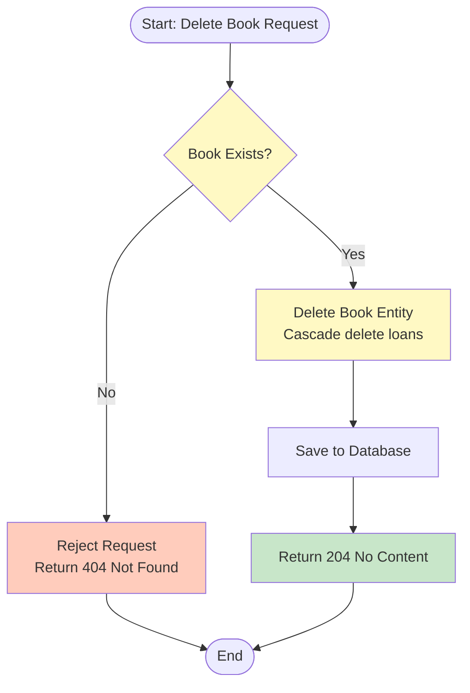
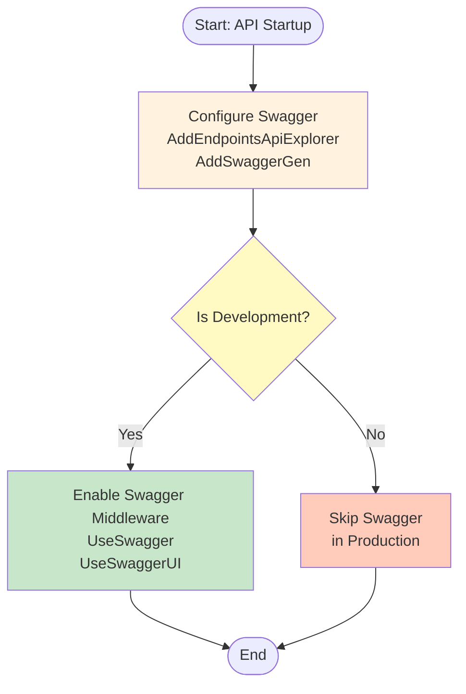
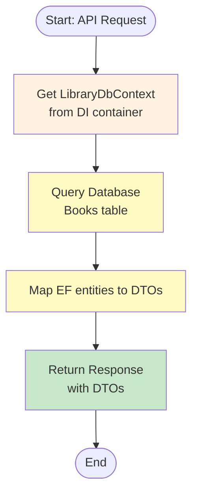
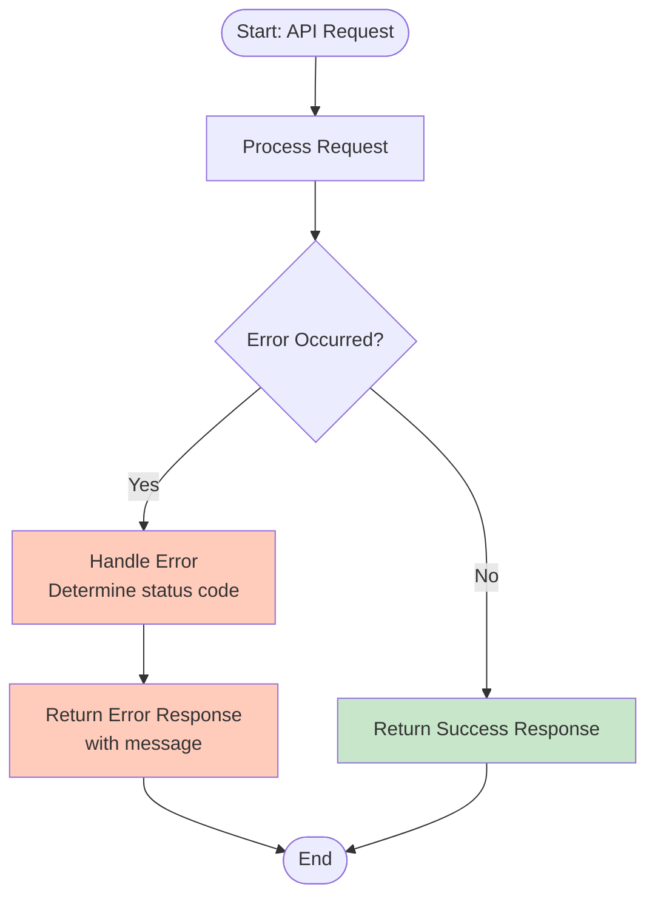
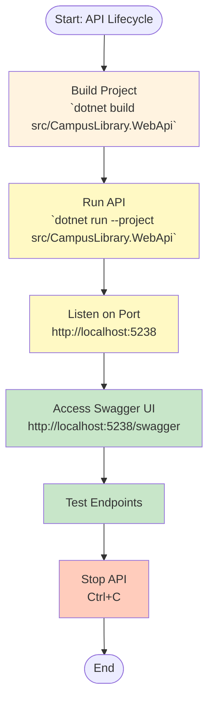
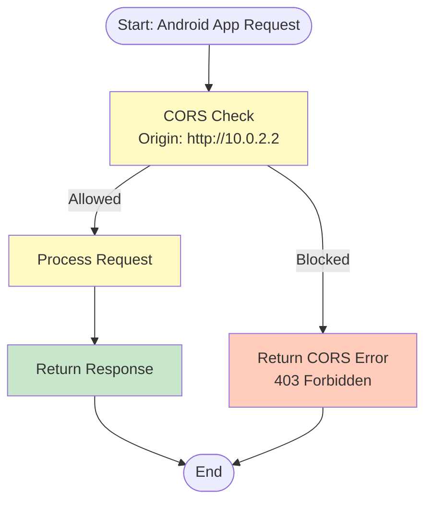
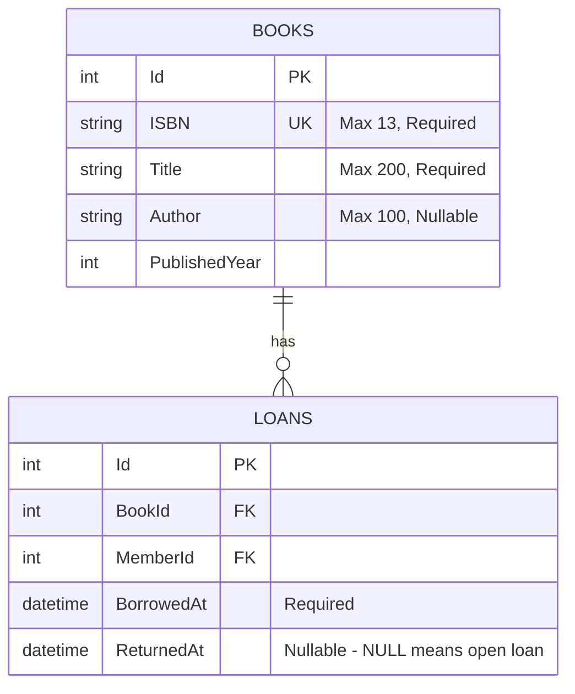
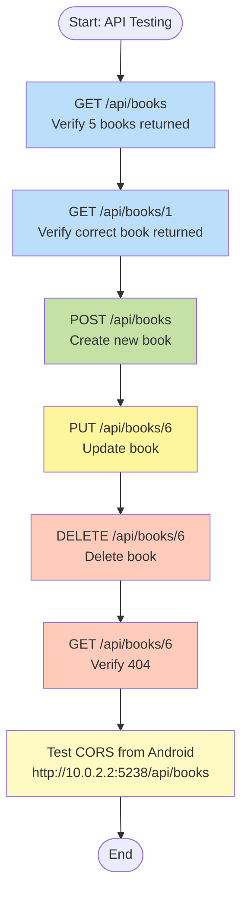

# Flowcharts: Web API Books CRUD + Swagger

## 1. API Endpoint Flow

```mermaid
flowchart TD
    Start([Start: API Request]) --> Route[Route to BooksController
/api/books] --> Method{HTTP Method} -->|GET| GetBooks[GET /api/books
List all books] --> ReturnBooks[Return 200 OK
with BookDto array] --> End([End])
    
    Method -->|GET| GetBook[GET /api/books/{id}
Get one book] --> CheckBook{Book Exists?} -->|Yes| ReturnBook[Return 200 OK
with BookDto] --> End
    CheckBook -->|No| Return404[Return 404 Not Found] --> End
    
    Method -->|POST| CreateBook[POST /api/books
Create new book] --> Validate[Validate Input
Check ISBN uniqueness] -->|Valid| SaveBook[Save to Database] --> Return201[Return 201 Created
with BookDto
Location header] --> End
    Validate -->|Invalid| Return400[Return 400 Bad Request
with validation errors] --> End
    Validate -->|Duplicate ISBN| Return409[Return 409 Conflict
"Book with ISBN already exists"] --> End
    
    Method -->|PUT| UpdateBook[PUT /api/books/{id}
Update book] --> CheckID{ID in URL
matches ID in body?} -->|No| Return400ID[Return 400 Bad Request
"ID mismatch"] --> End
    CheckID -->|Yes| ValidateUpdate[Validate Input
Check ISBN uniqueness
(ignore current book)] -->|Valid| UpdateDB[Update in Database] --> Return204[Return 204 No Content] --> End
    ValidateUpdate -->|Invalid| Return400Update[Return 400 Bad Request
with validation errors] --> End
    ValidateUpdate -->|Duplicate ISBN| Return409Update[Return 409 Conflict
"Book with ISBN already exists"] --> End
    
    Method -->|DELETE| DeleteBook[DELETE /api/books/{id}
Delete book] --> CheckDelete{Book Exists?} -->|Yes| RemoveBook[Remove from Database] --> Return204Delete[Return 204 No Content] --> End
    CheckDelete -->|No| Return404Delete[Return 404 Not Found] --> End
    
    style GetBooks fill:#bbdefb
    style GetBook fill:#bbdefb
    style CreateBook fill:#c5e1a5
    style UpdateBook fill:#fff59d
    style DeleteBook fill:#ffccbc
    style Return201 fill:#c8e6c9
    style Return204 fill:#c8e6c9
    style Return400 fill:#ffccbc
    style Return404 fill:#ffccbc
    style Return409 fill:#ffccbc
```

## 2. Book Creation Flow

```mermaid
flowchart TD
    Start([Start: Create Book Request]) --> ValidateInput[Validate Input
ISBN (13 chars), Title (required)] --> CheckISBN{ISBN
Already Exists?} -->|Yes| Reject[Reject Request
Return 409 Conflict] --> End([End])
    
    CheckISBN -->|No| CreateEntity[Create Book Entity
Map DTO to EF entity] --> SaveDB[Save to Database] --> MapDTO[Map EF entity to DTO] --> Return201[Return 201 Created
with BookDto
Location header] --> End
    
    style ValidateInput fill:#fff3e0
    style CheckISBN fill:#fff9c4
    style CreateEntity fill:#fff9c4
    style Return201 fill:#c8e6c9
    style Reject fill:#ffccbc
```

## 3. Book Update Flow

```mermaid
flowchart TD
    Start([Start: Update Book Request]) --> CheckID{ID in URL
matches ID in body?} -->|No| RejectID[Reject Request
Return 400 Bad Request
"ID mismatch"] --> End([End])
    
    CheckID -->|Yes| ValidateInput[Validate Input
ISBN (13 chars), Title (required)] --> CheckISBN{ISBN
Already Exists?
(ignore current book)} -->|Yes| RejectISBN[Reject Request
Return 409 Conflict
"Book with ISBN already exists"] --> End
    
    CheckISBN -->|No| UpdateEntity[Update Book Entity
Map DTO to EF entity] --> SaveDB[Save to Database] --> Return204[Return 204 No Content] --> End
    
    style CheckID fill:#fff3e0
    style ValidateInput fill:#fff3e0
    style CheckISBN fill:#fff9c4
    style UpdateEntity fill:#fff9c4
    style Return204 fill:#c8e6c9
    style RejectID fill:#ffccbc
    style RejectISBN fill:#ffccbc
```

## 4. Book Deletion Flow



## 5. Swagger Integration Flow



## 6. CORS Configuration Flow

```mermaid
flowchart TD
    Start([Start: API Startup]) --> ConfigCORS[Configure CORS
AddPolicy for Android Emulator] --> UseCORS[Use CORS Middleware
UseCors("AndroidEmulator")] --> End([End])
    
    style ConfigCORS fill:#fff3e0
    style UseCORS fill:#c8e6c9
```

## 7. Database Access Flow



## 8. Error Handling Flow



## 9. API Lifecycle Flow



## 10. Android Emulator Access Flow



## 11. Book Entity Relationship Diagram



## 12. API Testing Flow


