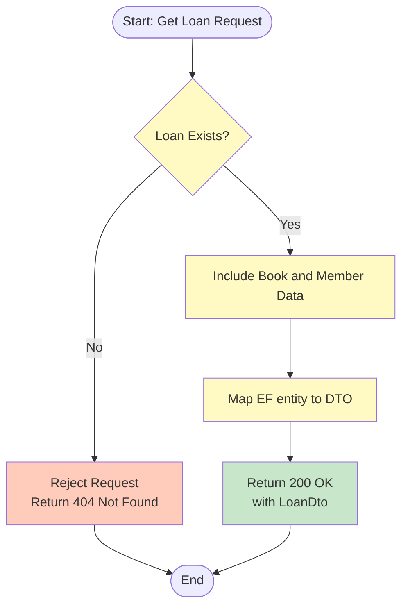
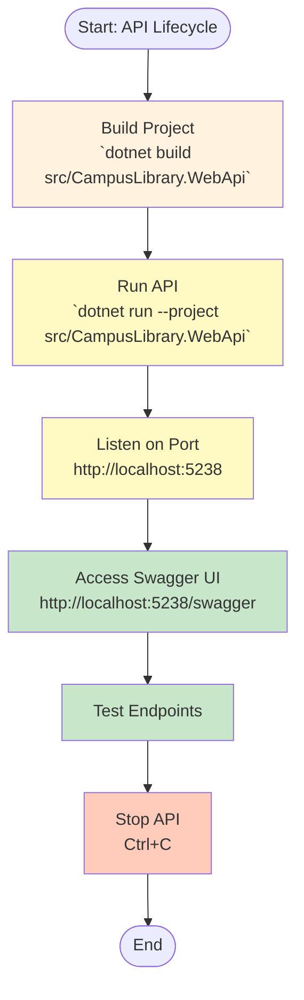
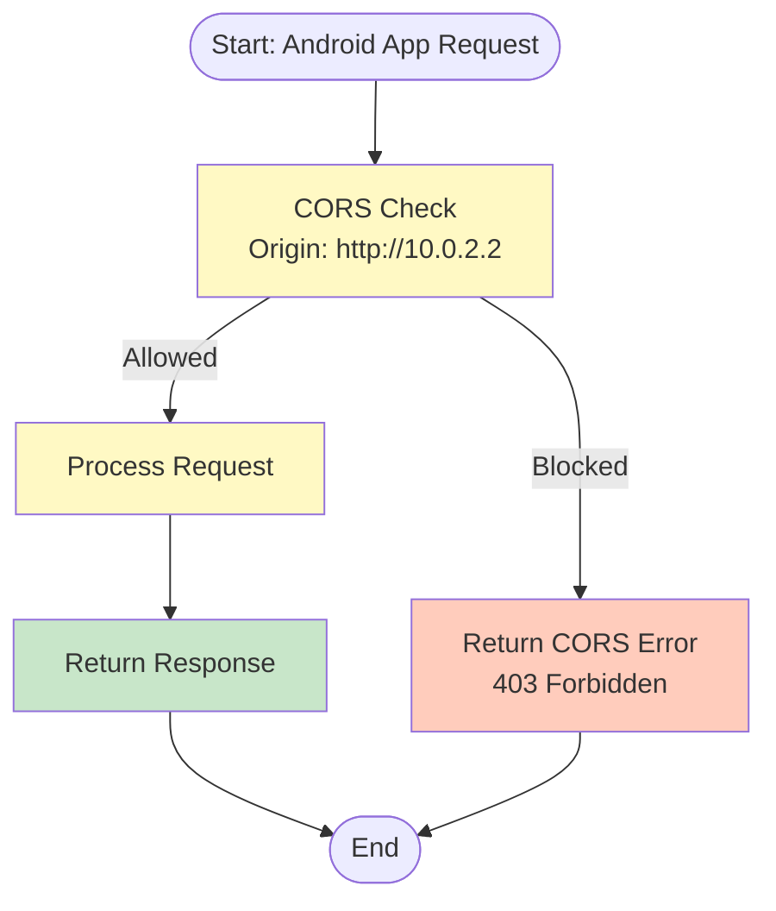
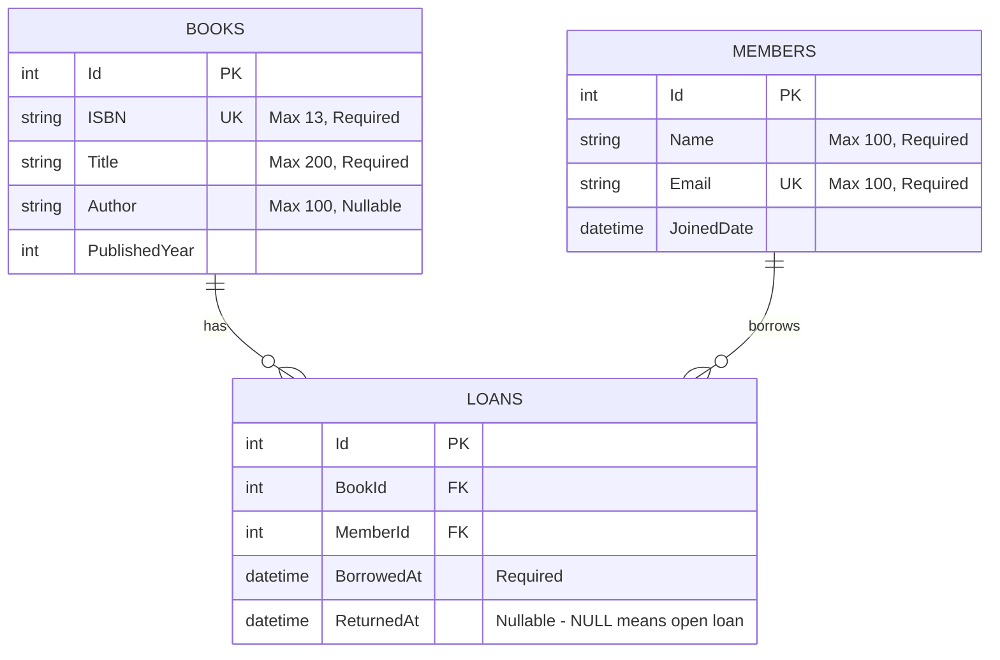
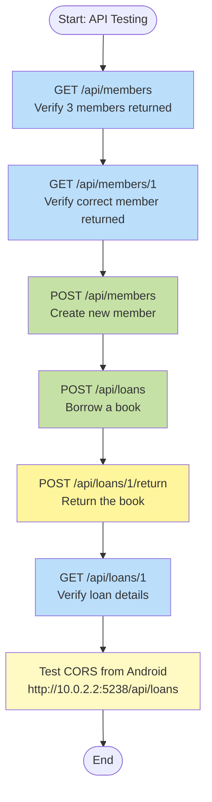

# Flowcharts: Web API Members + Loans

## 1. Members Endpoint Flow

```mermaid
flowchart TD
    Start([Start: API Request]) --> Route[Route to MembersController
/api/members] --> Method{HTTP Method} -->|GET| GetMembers[GET /api/members
List all members] --> ReturnMembers[Return 200 OK
with MemberDto array] --> End([End])
    
    Method -->|GET| GetMember[GET /api/members/{id}
Get one member] --> CheckMember{Member Exists?} -->|Yes| ReturnMember[Return 200 OK
with MemberDto] --> End
    CheckMember -->|No| Return404[Return 404 Not Found] --> End
    
    Method -->|POST| CreateMember[POST /api/members
Create new member] --> Validate[Validate Input
Check email uniqueness] -->|Valid| SaveMember[Save to Database] --> Return201[Return 201 Created
with MemberDto
Location header] --> End
    Validate -->|Invalid| Return400[Return 400 Bad Request
with validation errors] --> End
    Validate -->|Duplicate Email| Return409[Return 409 Conflict
"Member with email already exists"] --> End
    
    style GetMembers fill:#bbdefb
    style GetMember fill:#bbdefb
    style CreateMember fill:#c5e1a5
    style Return201 fill:#c8e6c9
    style Return400 fill:#ffccbc
    style Return404 fill:#ffccbc
    style Return409 fill:#ffccbc
```

## 2. Loans Endpoint Flow

```mermaid
flowchart TD
    Start([Start: API Request]) --> Route[Route to LoansController
/api/loans] --> Method{HTTP Method} -->|POST| BorrowBook[POST /api/loans
Borrow a book] --> CheckBook{Book Exists?} -->|No| Return404Book[Return 404 Not Found] --> End([End])
    CheckBook -->|Yes| CheckMember{Member Exists?} -->|No| Return404Member[Return 404 Not Found] --> End
    CheckMember -->|Yes| CheckLoan{Book Already on Loan?} -->|Yes| Return409Loan[Return 409 Conflict
"Book already on loan"] --> End
    CheckLoan -->|No| CreateLoan[Create Loan
Set BorrowedAt = Now
ReturnedAt = NULL] --> SaveLoan[Save to Database] --> Return201Loan[Return 201 Created
with LoanDto
Location header] --> End
    
    Method -->|POST| ReturnBook[POST /api/loans/{id}/return
Return a book] --> CheckLoanExists{Loan Exists?} -->|No| Return404Loan[Return 404 Not Found] --> End
    CheckLoanExists -->|Yes| CheckReturned{Already Returned?} -->|Yes| Return409Return[Return 409 Conflict
"Loan already returned"] --> End
    CheckReturned -->|No| UpdateLoan[Update Loan
Set ReturnedAt = Now] --> SaveReturn[Save to Database] --> Return204[Return 204 No Content] --> End
    
    Method -->|GET| GetLoan[GET /api/loans/{id}
Get loan details] --> CheckLoanGet{Loan Exists?} -->|No| Return404Get[Return 404 Not Found] --> End
    CheckLoanGet -->|Yes| ReturnLoan[Return 200 OK
with LoanDto] --> End
    
    style BorrowBook fill:#c5e1a5
    style ReturnBook fill:#fff59d
    style GetLoan fill:#bbdefb
    style Return201Loan fill:#c8e6c9
    style Return204 fill:#c8e6c9
    style Return404Book fill:#ffccbc
    style Return404Member fill:#ffccbc
    style Return404Loan fill:#ffccbc
    style Return404Get fill:#ffccbc
    style Return409Loan fill:#ffccbc
    style Return409Return fill:#ffccbc
```

## 3. Loan Business Rule Flow

```mermaid
flowchart TD
    Start([Start: Borrow Request]) --> CheckBook{Book Exists?} -->|No| RejectBook[Reject Request
Return 404 Not Found] --> End([End])
    CheckBook -->|Yes| CheckMember{Member Exists?} -->|No| RejectMember[Reject Request
Return 404 Not Found] --> End
    CheckMember -->|Yes| CheckLoan{Book Already on Loan?
(ReturnedAt IS NULL)} -->|Yes| RejectLoan[Reject Request
Return 409 Conflict
"Book already on loan"] --> End
    CheckLoan -->|No| CreateLoan[Create Loan
Set BorrowedAt = Now
ReturnedAt = NULL] --> SaveLoan[Save to Database] --> Return201[Return 201 Created
with LoanDto] --> End
    
    style CheckBook fill:#fff3e0
    style CheckMember fill:#fff3e0
    style CheckLoan fill:#fff9c4
    style CreateLoan fill:#fff9c4
    style Return201 fill:#c8e6c9
    style RejectBook fill:#ffccbc
    style RejectMember fill:#ffccbc
    style RejectLoan fill:#ffccbc
```

## 4. Member Creation Flow

```mermaid
flowchart TD
    Start([Start: Create Member Request]) --> ValidateInput[Validate Input
Name (required), Email (required, unique)] --> CheckEmail{Email
Already Exists?} -->|Yes| Reject[Reject Request
Return 409 Conflict
"Member with email already exists"] --> End([End])
    
    CheckEmail -->|No| CreateEntity[Create Member Entity
Map DTO to EF entity] --> SaveDB[Save to Database] --> MapDTO[Map EF entity to DTO] --> Return201[Return 201 Created
with MemberDto
Location header] --> End
    
    style ValidateInput fill:#fff3e0
    style CheckEmail fill:#fff9c4
    style CreateEntity fill:#fff9c4
    style Return201 fill:#c8e6c9
    style Reject fill:#ffccbc
```

## 5. Book Borrowing Flow

```mermaid
flowchart TD
    Start([Start: Borrow Request]) --> CheckBook{Book Exists?} -->|No| RejectBook[Reject Request
Return 404 Not Found] --> End([End])
    CheckBook -->|Yes| CheckMember{Member Exists?} -->|No| RejectMember[Reject Request
Return 404 Not Found] --> End
    CheckMember -->|Yes| CheckLoan{Book Already on Loan?
(ReturnedAt IS NULL)} -->|Yes| RejectLoan[Reject Request
Return 409 Conflict
"Book already on loan"] --> End
    CheckLoan -->|No| CreateLoan[Create Loan
Set BorrowedAt = Now
ReturnedAt = NULL] --> SaveDB[Save to Database] --> MapDTO[Map EF entity to DTO
with Book and Member data] --> Return201[Return 201 Created
with LoanDto
Location header] --> End
    
    style CheckBook fill:#fff3e0
    style CheckMember fill:#fff3e0
    style CheckLoan fill:#fff9c4
    style CreateLoan fill:#fff9c4
    style MapDTO fill:#fff9c4
    style Return201 fill:#c8e6c9
    style RejectBook fill:#ffccbc
    style RejectMember fill:#ffccbc
    style RejectLoan fill:#ffccbc
```

## 6. Book Returning Flow

```mermaid
flowchart TD
    Start([Start: Return Request]) --> CheckLoan{Loan Exists?} -->|No| RejectLoan[Reject Request
Return 404 Not Found] --> End([End])
    CheckLoan -->|Yes| CheckReturned{Already Returned?} -->|Yes| RejectReturned[Reject Request
Return 409 Conflict
"Loan already returned"] --> End
    CheckReturned -->|No| UpdateLoan[Update Loan
Set ReturnedAt = Now] --> SaveDB[Save to Database] --> Return204[Return 204 No Content] --> End
    
    style CheckLoan fill:#fff9c4
    style CheckReturned fill:#fff9c4
    style UpdateLoan fill:#fff9c4
    style Return204 fill:#c8e6c9
    style RejectLoan fill:#ffccbc
    style RejectReturned fill:#ffccbc
```

## 7. Loan Details Flow



## 8. API Lifecycle Flow



## 9. Android Emulator Access Flow



## 10. Entity Relationship Diagram



## 11. API Testing Flow


