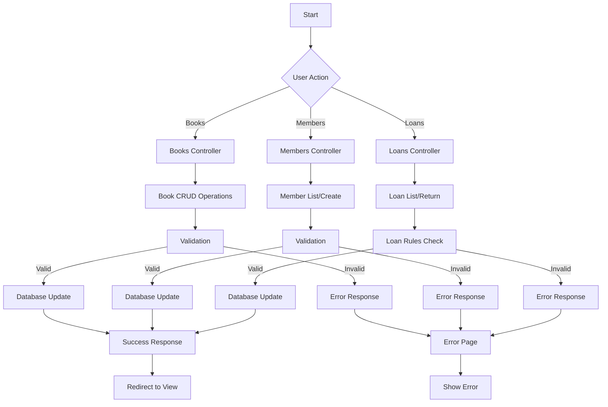
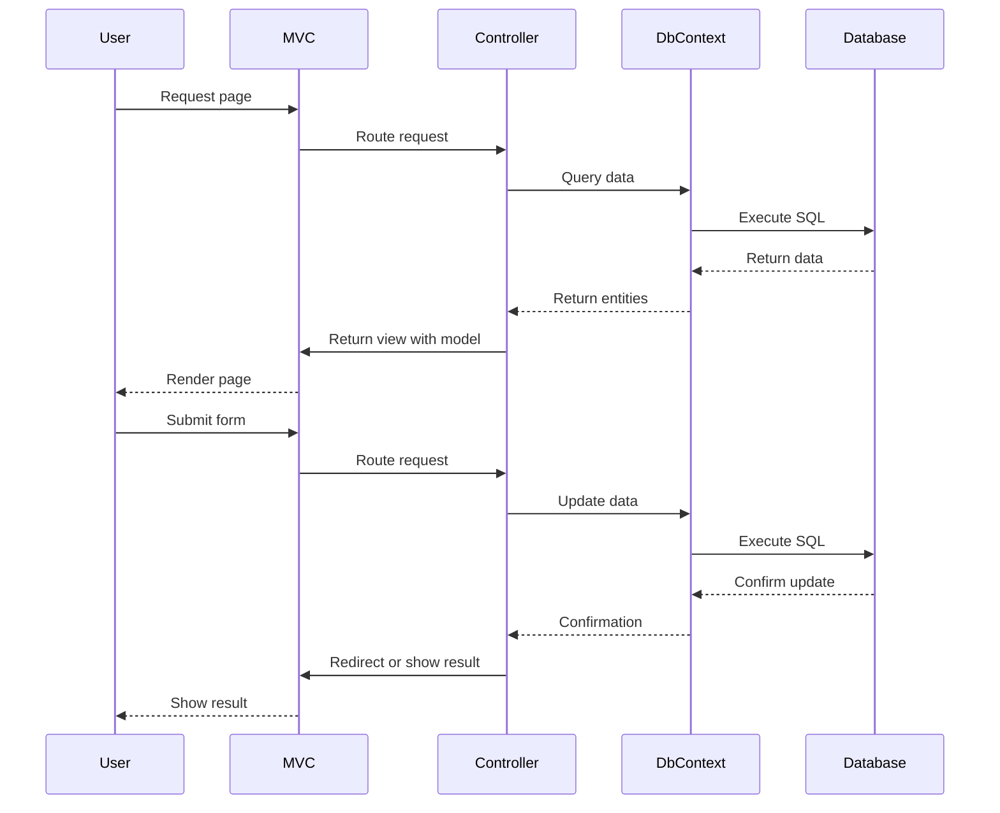
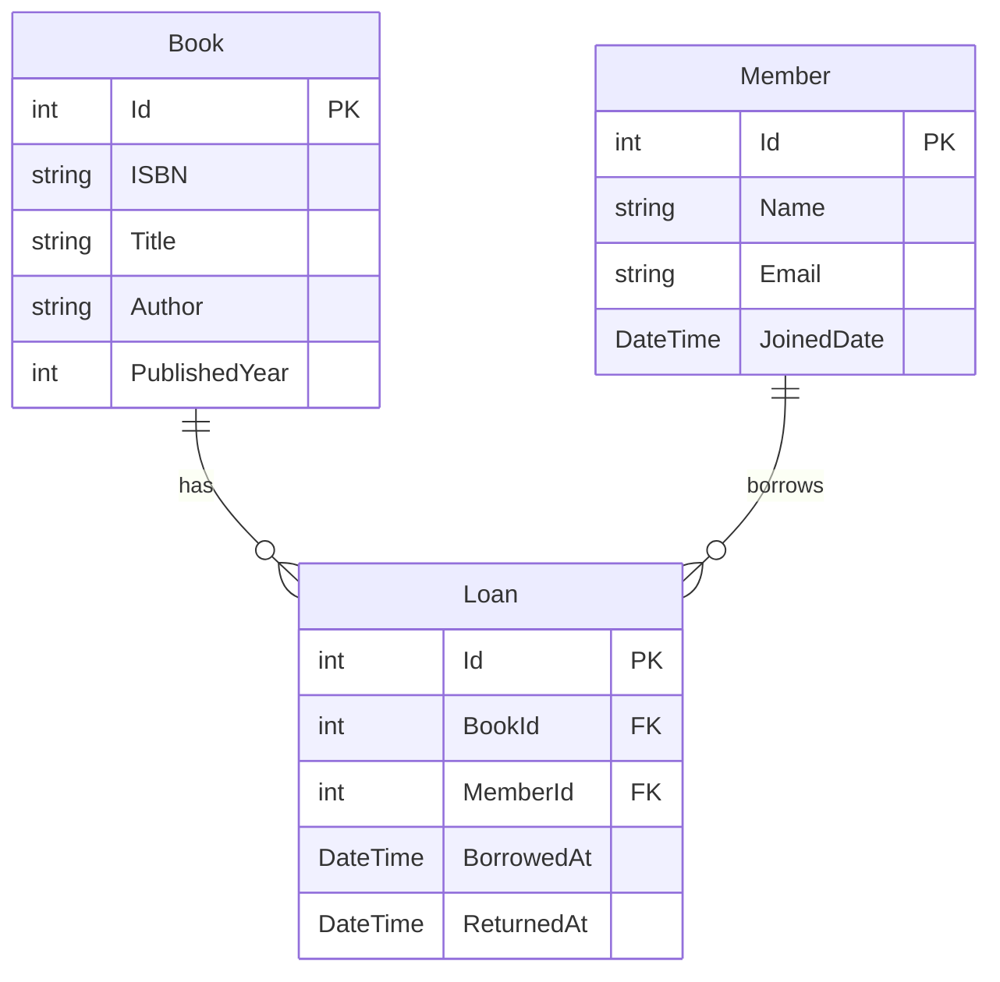
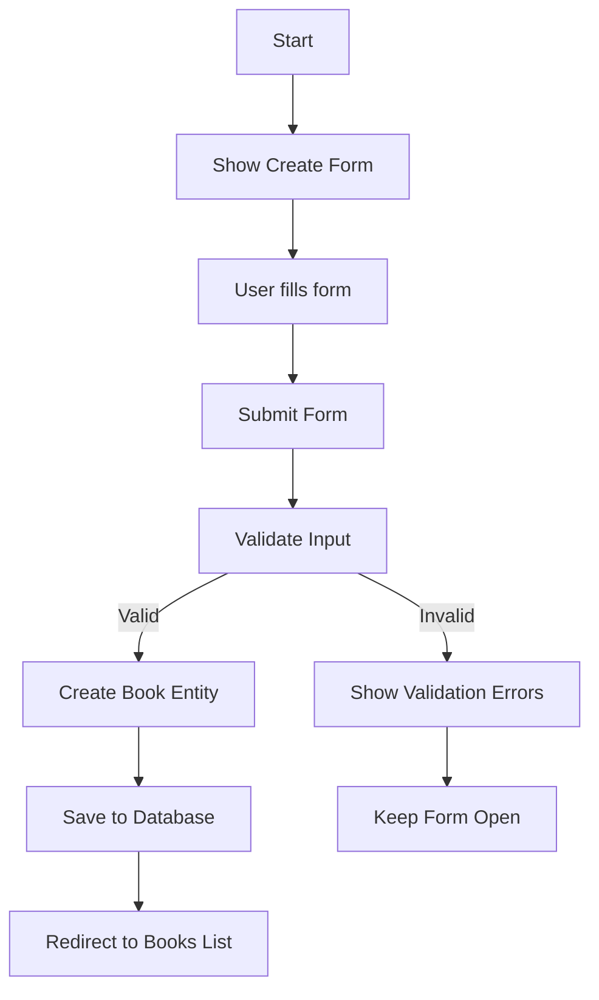
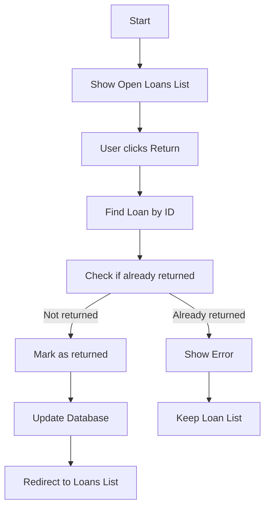
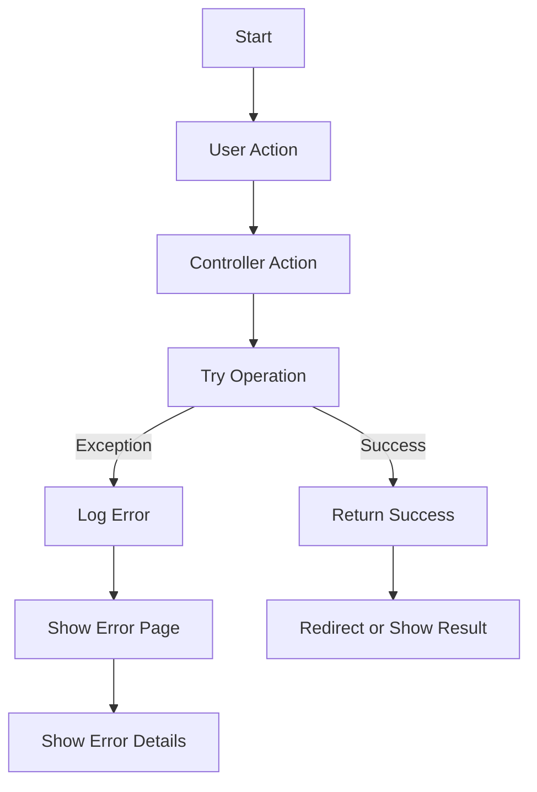
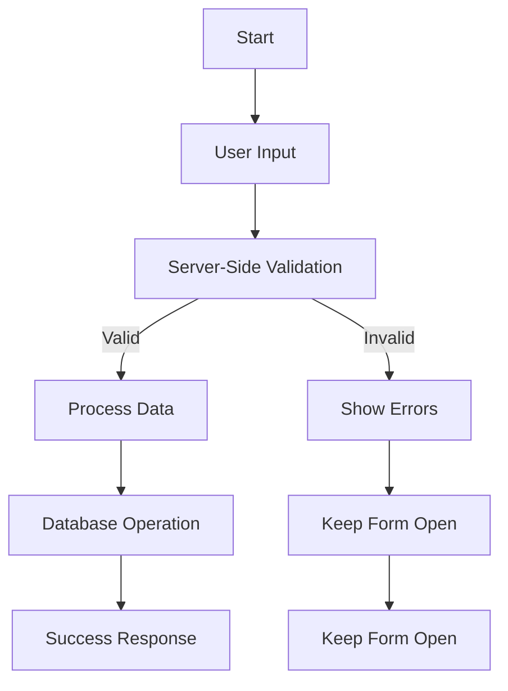
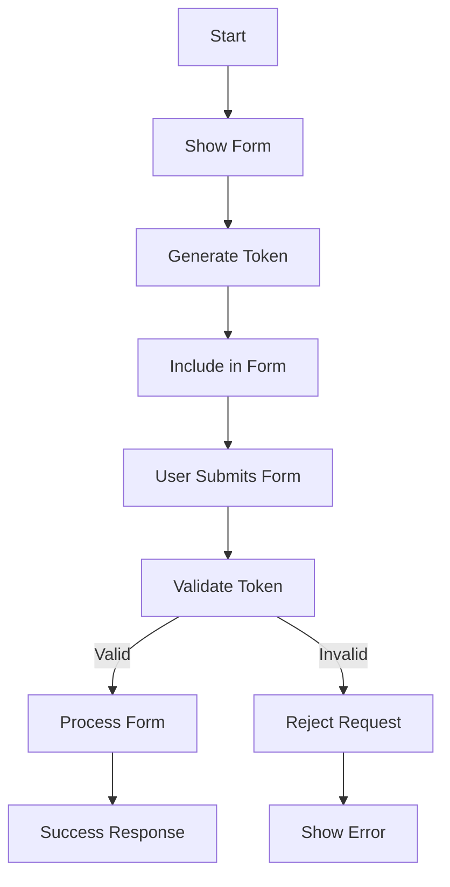
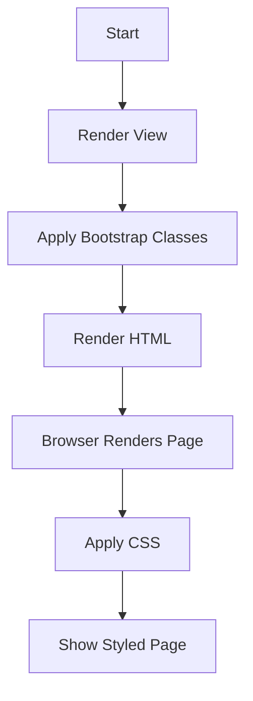
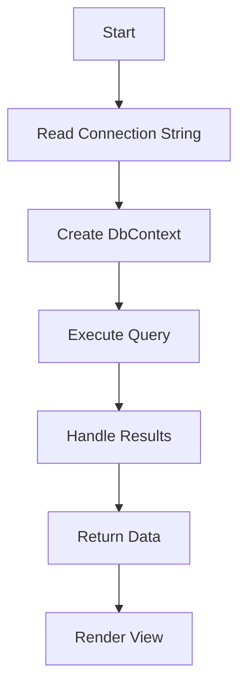

# Flowcharts: Web MVC Admin Pages

## 1. Feature Logic Flowchart

## 2. Sequence Diagram

## 3. Database Schema Diagram

## 4. Book Creation Flow

## 5. Loan Return Flow

## 6. Error Handling Flow

## 7. Validation Flow

## 8. Anti-Forgery Token Flow

## 9. Bootstrap Styling Flow

## 10. Database Connection Flow

## Key Notes

1. The feature logic flowchart shows the main paths through the admin interface, including validation and error handling.
2. The sequence diagram illustrates the interaction between components when handling requests and database operations.
3. The database schema diagram shows the relationships between the Book, Member, and Loan entities.
4. The book creation and loan return flows show the specific processes for these operations.
5. The error handling and validation flows demonstrate how the system manages these critical aspects of the application.
6. The anti-forgery token and Bootstrap styling flows show how these security and UI features are implemented.
7. The database connection flow shows how the application connects to and interacts with the database.

These flowcharts provide a visual representation of the Web MVC admin interface's architecture and logic, making it easier to understand the flow of data and control through the system.