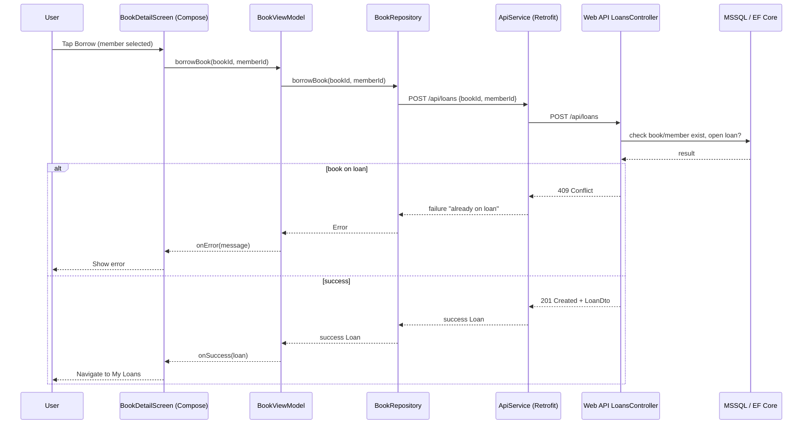

# Flowcharts — Impeccable UI fixes

## flowchart TD — Borrow a book (web + Android, shared logic)

```mermaid
flowchart TD
    A[User opens book detail / list] --> B{Book available?}
    B -- No --> C[Show "On loan to <member>" / disable Borrow]
    B -- Yes --> D[Android: member picker dropdown / Web: N/A]
    D --> E[User selects member]
    E --> F[Tap Borrow]
    F --> G[Validate member + book exist]
    G -- Invalid --> H[400/404 error → show message]
    G -- Valid --> I{Book already on loan?}
    I -- Yes --> J[409 Conflict → "Already on loan", disable Borrow]
    I -- No --> K[Create loan, BorrowedAt = now]
    K --> L[Return loan DTO to client]
    L --> M[Android: navigate to My Loans / Web: Open Loans updated]
```

## sequenceDiagram — Android borrow flow



## erDiagram — affected tables (no schema change)

No tables or columns were added; availability is computed from existing `Loan.ReturnedAt == null`.

```mermaid
erDiagram
    Book ||--o{ Loan : has
    Member ||--o{ Loan : has
    Book {
        int Id PK
        string ISBN UK
        string Title
    }
    Member {
        int Id PK
        string Name
        string Email
    }
    Loan {
        int Id PK
        int BookId FK
        int MemberId FK
        DateTime BorrowedAt
        DateTime? ReturnedAt
    }
```
